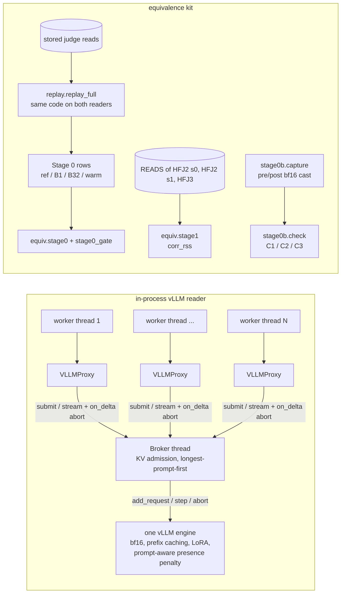

# judge-lab

Tooling from a project that trains and evaluates LLM judges for olympiad-level mathematical proofs: LoRA adapters on Qwen3.5-9B,
read by a judge that thinks (uncapped, up to a 65,536-token slot) and then emits a structured verdict (first error, severity, score).

This repository contains the parts that are general and can be published:

1. **A fast in-process vLLM judge reader** (`engine`, `proxy`, `verdicts`, `logits`): many judge-worker threads share one vLLM engine
   through a thread-safe broker, so independent judge calls are batched continuously and share prefix-cache entries. The proxy reproduces
   the request semantics of the reference HTTP judge server, so the judge client runs unchanged on top of it.
2. **A reader-equivalence test kit** (`replay`, `equiv`, `stage0_gate`, `stage0b`): before a faster reader may replace the reference
   reader in an evaluation, it must be shown to produce the same judgements, at the level of logits (Stage 0), score distributions
   (Stage 1) and, when a small discrepancy remains, bf16 rounding mechanics (Stage 0b).

Not included: the production judge client (prompts, rubric, verdict format), all data (problems, proofs, human marks, reads), adapters
and model weights. `judgelab.protocol.ExampleProtocol` is an illustrative stand-in for the client contract so that the transport and
the replay can be exercised end to end on CPU; its constants are not the values of any real run.

Reader names used as schema labels: **HFJ2** = the reference Hugging Face transformers bf16 reader; **HFJ3** = the in-process vLLM reader.

## Architecture



## Module map

| module | contents |
|---|---|
| `src/judgelab/protocol.py` | judge-client contract (request bodies, verdict-prefix fragments, loop detector); `ExampleProtocol` is illustrative |
| `src/judgelab/engine.py` | `Broker` (one engine thread, thread-safe `submit`/`stream`), engine contract assertions, `FakeEngine` for CPU tests |
| `src/judgelab/proxy.py` | `VLLMProxy`: `tokenize` / `stream_think` / `complete` with the reference server's per-token stop rules |
| `src/judgelab/verdicts.py` | top-100 logprob read and greedy extraction with the reference semantics (local stop-string rule) |
| `src/judgelab/logits.py` | `PromptAwarePresencePenalty`, a vLLM V1 logits processor that also penalises prompt tokens, as the reference does |
| `src/judgelab/replay.py` | one teacher-forced verdict replay used by both readers; stratified Stage 0 call selection |
| `src/judgelab/equiv.py` | Stage 0 and Stage 1 gates (numpy + stdlib only; imports no reader code) |
| `src/judgelab/stage0_gate.py` | Stage 0 verdict with input pre-checks (call sets, GPU class, row counts, prefix-cache bounds, gate-code pin) |
| `src/judgelab/stage0b/capture.py` | hooks that copy hidden row, weight rows and bf16 logits; exact pre-cast reconstruction with error bounds |
| `src/judgelab/stage0b/check.py` | checks whether a cross-engine shift is fully explained by one bf16 rounding flip per logit |

Command-line entry points:

```
python -m judgelab.equiv stage0 --rows ROWS_HFJ2.jsonl ROWS_HFJ3.jsonl --out S0.json
python -m judgelab.equiv stage1 --hfj2-s0 DIR --hfj2-s1 DIR --hfj3 DIR --calls CALLS --labels LABELS.jsonl --arm BASE --out S1.json
python -m judgelab.stage0_gate ROWS_HFJ2.jsonl ROWS_HFJ3.jsonl HFJ2.out HFJ3.out REPORT.json [--gpu "NVIDIA L40S"] [--expect-gate-sha PREFIX]
python -m judgelab.stage0b.check CAPTURE_HFJ2.json CAPTURE_HFJ3.json REPORT.json --pin PIN.json
```

Dropped from the original working code: the reader and replay CLI drivers and the Stage 0b engine runners. They depend on the
unpublished reference reader kit (journaling, model loading, input pinning). Hard-coded pins to private files became CLI arguments.
`examples/run_reader.sbatch` shows the batch-job pattern with a placeholder reader command.

## Quick start

```
pip install -e .[test]          # numpy + pytest; torch / tokenizers / vllm are optional extras
python -m pytest -q             # CPU only; tests needing torch are skipped when it is absent
```

All tests run on CPU against fakes: a scripted `FakeEngine`, a tiny bf16 model for the capture hooks, a fake vLLM logits-processor
module tree, and synthetic read panels at a realistic noise level for the statistical gates. No GPU, model or dataset is needed.

## Status (honest)

- The vLLM reader has run production-shaped read shards on L40S GPUs. Its use in the deciding evaluation is gated by the
  equivalence kit; that decision was still open at the time of writing.
- Stage 0 (logit-level replay, 24 calls per arm): passed except on 2 deterministic calls with a 0.25 log-ratio shift between readers.
- Stage 0b on one of those calls: the reconstructed pre-cast fp32 logits differ by 0.12818, more than one bf16 step (0.125) at that
  magnitude (reconstruction error <= 5.4e-5). So the shift is **not** a single rounding flip. Consequence: HFJ2 and HFJ3 reads are
  never mixed inside one comparison.
- Stage 1 (distributional, blind), BASE arm: PASS on 720 calls / 360 proofs / 78 problems. This is an equivalence-test outcome, not a
  judge-quality result. The ADAPTER-arm Stage 1 was pending at the time of writing.
- Judge-gain results are **not reported here**: the final pre-registered evaluation is pending.

## Engineering results (measured unless labelled)

| item | value |
|---|---|
| reference HF reader, unbatched | ~30-35 gen tok/s per L40S (35.5 measured) |
| in-process vLLM reader, full-batch bench | 2,081 gen tok/s at batch 128 on an A100-40GB (bench workload) |
| in-process vLLM reader, production shards | 195-328 gen tok/s per L40S; tail-bound (24-call shards: ~6-13 live requests on average) |
| MTP-3 speculative decoding | 1.848x at batch 24, measured without runtime LoRA; not yet certified with LoRA |
| bf16 cross-engine finding | pre-cast logit drift 0.12818 vs one bf16 step 0.125: readers must not be mixed |

Details, sources of each number and projected levers: [docs/PERFORMANCE.md](docs/PERFORMANCE.md).
Method: [docs/METHODOLOGY.md](docs/METHODOLOGY.md). Equivalence tests: [docs/READER_EQUIVALENCE.md](docs/READER_EQUIVALENCE.md).

## License

MIT, see [LICENSE](LICENSE).
